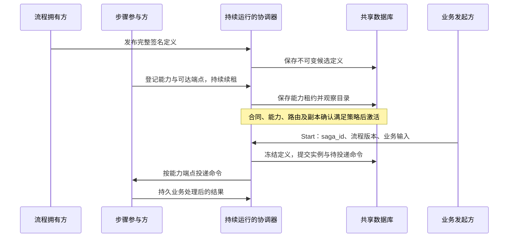

# 业务接入

业务侧分为三个职责：流程拥有方定义完整工作流并签名发布；参与方执行本地事务、补偿与结果裁决；发起方创建和查询 Saga。一个业务服务可以同时承担流程拥有方与参与方，但 `saga-server` 只承担协调角色。

## 流程动态上报与服务端持续运行

已建立信任的业务微服务新增分布式事务时，saga-server 保持运行，不修改 YAML、不热加载、也不重启。上报分为三个不同的业务动作：

1. 流程拥有方通过受管客户端主动发布完整的签名定义，包括 `workflow`、`definition_version`、步骤顺序、参与服务身份、输入输出合同、补偿和超时语义。
2. 各参与方主动登记步骤能力、定义摘要、可达端点与租约，持续续租。协调器从持久 Catalog 动态装载定义与能力，符合 `validated` 策略后自动激活；步骤尚未齐备时拒绝新流程的 Start。
3. 发起方通过 Saga client 提交 `saga_id`、流程定义身份和业务输入。每个 `saga_id` 对应具体事务实例；它不是需要写进服务端配置的流程名。执行期间，参与方继续上报步骤结果。

模板中的 `workflows: ["*"]` 允许可信 Registry caller 在其 `tenants` 范围内使用任意合法流程名，支持未知新流程名。身份认证、定义签名、租户权限和参与方地址白名单仍须满足；通配授权不会扩大租户或网络范围，但不再按流程名称限制该主体；定义发布及生命周期管理仍受流程归属检查约束。需要逐流程隔离时可配置精确名称列表，此时新增名称需要修改授权策略，不适合直接用作无需服务端配置变更的接入方式。

业务流程与部署信任配置分别管理：新增流程沿用已授权身份、公钥、租户和网络范围时只更新业务侧；新增不受信身份、公钥或网络范围需要相应的信任配置变更。业务服务部署新代码不要求协调器重启。协调器本身需要维护或故障恢复时仍支持受控重启，持久事实不会因进程停止而删除。

同名同版本定义的相同摘要可以幂等重报，不同摘要拒绝覆盖。已有实例冻结定义版本与摘要；运行中新增流程或定义版本不改变这些实例。配置中的 `watch_interval_ms` 控制动态目录观察间隔，不是 YAML 热加载周期。



| 业务变化 | 业务侧操作 | 协调服务配置 |
| --- | --- | --- |
| 已授权拥有方新增流程名 | 发布完整定义，登记各步骤能力，激活后发起 | 模板的通配流程范围内无需变更 |
| 修改步骤顺序、合同或补偿行为 | 发布新的定义版本，保留旧实例需要的步骤能力 | 已有信任范围内无需变更 |
| 再次执行已有流程 | 生成新的 `saga_id`；同一执行的重试保持原身份与内容 | 无需变更 |
| 新增未授权身份、租户、公钥或网络范围 | 先完成接入授权，再发布定义或能力 | 属于部署信任变更，按配置加载规则生效 |

发布定义成功不等于已经允许 Start。`validated` 策略还需完整能力与目录确认；`approved` 策略需要授权管理方激活。未激活时调用方应核对定义状态、参与方续租及目录同步，不能用更换 `saga_id` 或重启协调器代替这些前置条件，参见[动态目录观测](monitoring.md#动态目录与新流程接入)。

## 参与方与流程拥有方

源码接入可使用 crates.io 依赖 `nasa = { version = "2.0.3", features = ["application", "saga-runtime", "web"] }`；具名发现额外开启对应 provider feature。参与方使用 PostgreSQL 时改用 `saga-runtime-pgsql`。每个参与服务按自己的实际数据库选择对应适配器，协调端和参与端可以使用不同数据库。

业务侧使用 `#[nasa::saga_workflow]` 声明完整 `WorkflowDefinition`，使用 `#[nasa::saga(..., managed = true)]` 实现 `SagaStep`。步骤必须明确补偿、取消、超时及结果裁决语义。`#[nasa::application("saga", "web")]` 接管协议入口、Inbox、gate、Outbox、能力续租及定义发布；业务启动钩子只准备自己的业务资源。

以下为参与方配置的 Saga 部分；同时配置其数据源、Outbox 和所引用的 secrets：

```yaml
saga:
  role: participant
  plan_mode: managed
  replica_identity: order-worker-0
  participant:
    service_identity: order-worker
    consumer_identity: order-worker-0
    orchestrator_identity: saga-server
    datasource_ref: default
  definition_catalog:
    mode: dynamic
    activation_policy: validated
    publish_tenants: [system]
    registry_client:
      protocol: http
      discovery_ref: http://saga-server:2070/_nasa/saga
      credential_ref: worker-http-key
      definition_signing_key_id: order-owner-key
      definition_signing_key_ref: workflow-private-key
  http:
    base_path: /_nasa/saga
  transport:
    command_result:
      kind: http
      http:
        shared_replay_claim: saga-http-replay
        orchestrator_discovery_ref: http://saga-server:2070/_nasa/saga
        advertised_endpoint: http://order-worker:2080
        command_credential_ref: command-http-key
        result_credential_ref: worker-http-key
        routing:
          mode: capability-registry
```

`command-http-key` 的材料与协调端 `saga-command` 相同；`worker-http-key` 与协调端 `producer_credentials.order-worker`、对应 Registry caller 的材料一致。`workflow-private-key` 是 Base64(PKCS8 DER) Ed25519 私钥，只在定义拥有方使用。仅执行步骤、不持有完整定义的参与方不配置签名私钥及其 key id。

协调端必须允许 `order-worker` 的租户、流程范围、签名公钥以及 `http://order-worker:2080` 地址。示例流程 `order_checkout` 在模板的 `workflows: ["*"]` 范围内，无需另加同名 YAML 条目。地址是协调容器能实际访问的入口，不是参与容器内部专用地址。`advertised_endpoint` 为 origin，实际 Saga base path 由参与方 capability 一并发布。

默认 `validated` 策略在定义、步骤合同、能力路由和资格满足后激活。`approved` 策略需要有 Registry 管理权限的主体显式激活。无 active 定义时服务可以 Ready，但指定未激活流程的 start 会拒绝。定义版本不可原地改变；同版本不同摘要冲突。旧实例继续使用冻结的定义。

完整协议和业务宏合同见 [NASA Saga 生产运行指南](https://github.com/nasa-runtime/nasa-runtime-rust/blob/master/docs/saga-production.md)。

## HTTP 地址与认证

默认基础地址是 `http://saga-server:2070/_nasa/saga`。通过宿主机映射、反向代理或 Nacos 获取地址时，必须保留最终路径与原始请求体；HMAC 对实际 path 签名，代理改写路径或重新序列化 JSON 会导致认证失败。HTTP 不加密正文，跨信任域使用 TLS。

多套 Nacos、Consul 的具名发现及注册配置见[多注册中心部署](discovery.md)。业务侧可以保留自己的连接，通过 `qualifier` 选择协调环境；新 Saga 使用普通服务别名，能力登记、定义同步及结果回传使用独立恢复别名。固定协调 URL 继续可用。Java/Go 作为步骤参与方需要实现完整协议适配；多副本代理不能仅按 `/readyz` 阻断全部恢复请求。

| 调用用途 | Rust 配置入口 | 发现或代理通道 |
| --- | --- | --- |
| 发起与查询 Saga | `saga.client.orchestrator_discovery_ref` | 普通业务服务别名或受信业务 URL |
| 能力登记、续租及定义同步 | `saga.definition_catalog.registry_client.discovery_ref` | 恢复服务别名或受信恢复 URL |
| 参与方结果回传 | `saga.transport.command_result.http.orchestrator_discovery_ref` | 恢复服务别名或受信恢复 URL |

需要具名发现时，在应用宏中同时声明 `"discovery"`，并配置对应的 `saga.discovery` 引用与
`discovery.connections`。恢复服务的后端名称可以是 `saga-server-recovery`，但其
`service_identity` 仍须是实际协调身份 `saga-server`。固定 URL 不使用 qualifier；具名发现
返回空集、未知 qualifier 或身份不符时拒绝调用，不会改用另一注册中心或固定地址。

发现只决定协调入口。参与方仍通过 `advertised_endpoint` 登记自己的可达 origin，协调器按能力
端点发送命令；在某个 Nacos 中注册同名业务服务，不会自动发布 Saga 步骤能力。Java/Go 的
发现客户端、HTTP 签名与参与协议由业务方集成，本项目不提供这些语言的自动注册适配器。

| 请求头 | 格式 |
| --- | --- |
| `x-saga-producer` | 与配置中 caller 的 key 相同，如 `order-api` |
| `x-saga-timestamp` | Unix 毫秒，双方时钟差在 30 秒以内 |
| `x-saga-nonce` | 每次 HTTP 尝试生成新的 16 字节随机数，32 个小写十六进制字符 |
| `x-saga-signature` | HMAC-SHA256，64 个小写十六进制字符 |
| `Content-Type` | JSON 请求使用 `application/json` |

签名 key 是 64 字符小写十六进制密钥解码后的 32 字节。签名消息按以下顺序拼接，每个 `\n` 是单个换行字节，正文尾部不额外加换行：

```text
nasaga-http-v2\n{producer}\n{path}\n{timestamp_ms}\n{nonce}\n{raw_body}
```

GET 使用空 body 签名，path 不含 query。每次重试更新 timestamp、nonce 和签名，但保留相同的业务幂等身份和原始业务内容。重放原 HTTP 请求返回 409；重新签名的相同业务意图返回 `Duplicate`。HTTP 超时、断连或 503 不证明事务未提交。

## 发起与查询

`POST /instances`：

```json
{"tenant_id":"system","saga_id":"order-1001","workflow":"order_checkout","definition_version":1,"business_key":"order-1001","trigger_id":"checkout-1001","input":{"order_id":"order-1001","quantity":1}}
```

| 字段 | 要求 |
| --- | --- |
| `tenant_id` | 必填，调用方被授权的租户 |
| `saga_id` | 必填，业务生成并在重试时保持不变的实例身份 |
| `workflow` / `definition_version` | 必填，已激活定义名及正整数版本 |
| `business_key` / `trigger_id` | 必填，稳定的业务身份与触发身份 |
| `expected_definition_digest` | 可选，指定期望定义摘要；不匹配返回冲突 |
| `deadline_at_ms` | 可选，Unix 毫秒期限，必须符合工作流约束 |
| `input` | 可选 JSON 业务输入，必须符合首步骤合同 |
| `payload` | 可选原始字节及 schema 载体；与 `input` 互斥，按 NASA `SagaPayload` 合同编码 |

首次持久提交返回 HTTP 200，响应含 `status: "Committed"`、`request_digest` 与 `saga` 快照；幂等命中返回 `status: "Duplicate"`。这只表示创建事实已提交，最终业务结果通过 `GET /instances/{tenant}/{saga_id}` 查询 `status`。

下面使用 Python 标准库发送签名请求。先在环境中设置实际 `SAGA_BASE_URL`、`SAGA_CLIENT_KEY`；流程已激活且示例 payload 与业务步骤一致时执行：

```python
import hashlib, hmac, json, os, secrets, time, urllib.request
from urllib.parse import urlsplit

url = os.environ["SAGA_BASE_URL"].rstrip("/") + "/instances"
producer = "order-api"
timestamp = str(int(time.time() * 1000))
nonce = secrets.token_hex(16)
body = json.dumps({"tenant_id": "system", "saga_id": "order-1001",
    "workflow": "order_checkout", "definition_version": 1,
    "business_key": "order-1001", "trigger_id": "checkout-1001",
    "input": {"order_id": "order-1001", "quantity": 1}}, separators=(",", ":")).encode()
material = ("nasaga-http-v2\n" + producer + "\n" + urlsplit(url).path + "\n"
    + timestamp + "\n" + nonce + "\n").encode() + body
signature = hmac.new(bytes.fromhex(os.environ["SAGA_CLIENT_KEY"]), material, hashlib.sha256).hexdigest()
request = urllib.request.Request(url, data=body, headers={
    "Content-Type": "application/json", "x-saga-producer": producer,
    "x-saga-timestamp": timestamp, "x-saga-nonce": nonce, "x-saga-signature": signature})
with urllib.request.urlopen(request, timeout=10) as response:
    print(response.status, response.read().decode())
```

NASA 业务服务也可使用受管远程 Saga client，避免自行处理签名。需要将业务事实与发起意图一起提交时使用 reliable client 的本地事务 Outbox；直接 HTTP 调用与业务数据库提交之间没有跨服务原子保证。

## 接口与失败语义

所有路径以实际 `saga.http.base_path` 为前缀，默认 `/_nasa/saga`，保留框架原生 HTTP 状态。

| 方法与路径 | 作用与权限 |
| --- | --- |
| `POST /instances` | 发起，`start` |
| `GET /instances/{tenant}/{saga_id}` | 查询，`read` |
| `POST /instances/query` | 按租户、流程、状态与游标查询，`read` |
| `GET /instances/{tenant}/{saga_id}/audit` | 审计，`audit` |
| `POST /instances/{tenant}/{saga_id}/pause`、`resume` | 管理暂停和恢复，`admin` 且开启管理入口 |
| `POST /instances/{tenant}/{saga_id}/retry-compensation`、`retry-resolution` | 受状态门禁约束的处置，`admin` |
| `POST /instances/{tenant}/{saga_id}/manual-close` | 人工关闭，还需 `enable_manual_close: true` |
| `POST /registry/capabilities` | 能力登记与续租，`registry` 及匹配流程权限 |
| `POST /registry/definitions` | 签名定义发布，`registry` 及匹配流程权限 |
| `GET /registry/definitions/{tenant}/{workflow}/{version}` | 读取定义，`registry` |
| `POST /registry/definitions/{tenant}/{workflow}/{version}/activate`、`deprecate`、`retire` | 定义生命周期管理，Registry 管理授权及状态检查 |
| `POST /results` | 受信参与方提交结果，由 NASA 参与端自动调用 |
| `GET /metrics` | 聚合 Saga 指标，不要求业务签名，限制网络访问 |

默认不开放实例管理端点；需要时在部署配置设置 `saga.api.http.expose_admin: true` 并增加独立操作方。管理请求包含操作身份、期望状态版本和处置参数，不能只用空 body 调用；应使用 NASA SDK 对应类型，以保留 CAS 与审计合同。

400 表示参数非法，401 表示认证失败，403 表示无权限，404 表示不存在，409 表示重放或业务/定义/CAS 冲突，422 表示业务前置条件未满足，429 表示配额限制，503 表示未就绪、依赖故障或结果不明。异常响应可能没有 JSON 正文，不应无条件解析 `{code,msg,data}`。重试应有预算与退避，持续冲突需要核对业务事实。
